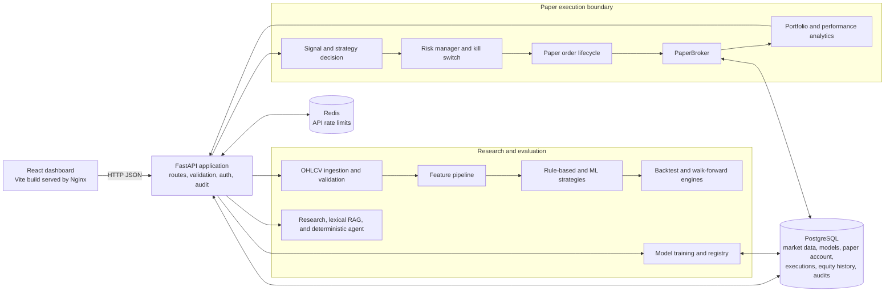
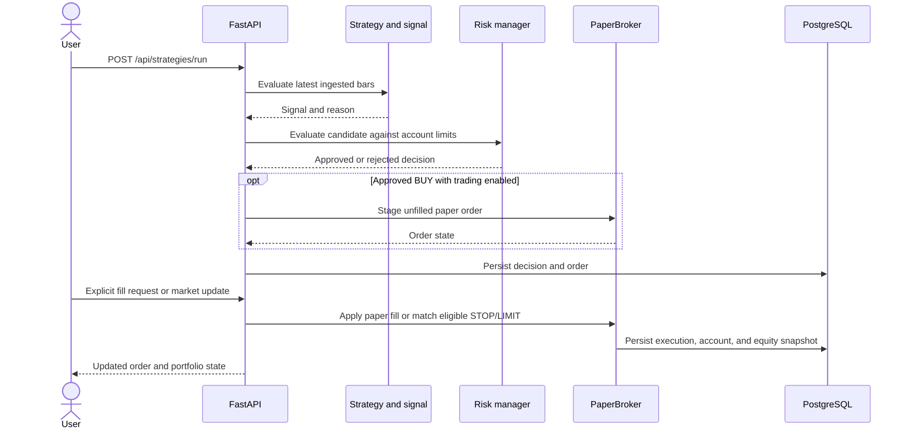

# Architecture

This document describes the system that is implemented today. It is a research and paper-trading application; it has no live broker adapter and does not send orders to an exchange.

## Runtime architecture

The dashboard is read-only. It displays API snapshots and does not create, submit, or fill orders. Market research and the research agent only use information supplied in the request; they do not fetch market news or call an LLM.

## Data and research flow

1. OHLCV bars enter through the market-data API or the local CSV provider. The ingestion endpoint validates bars, persists accepted input in PostgreSQL, and updates the running application's in-memory market-data cache.
2. Feature engineering validates and sorts bars, then calculates trailing-window indicators per symbol. Warm-up values remain missing. Features use current and prior observations only.
3. Strategies emit structured signals. Generating signals is separate from creating orders. Backtests execute close-time signals no earlier than the next bar and apply configured costs. Walk-forward ML fits separately from each fold's later test window.
4. Model training uses chronological partitions and stores model artifacts and metadata in PostgreSQL. Prediction outcomes can be recorded later; monitoring compares observations with the stored training baseline.
5. The AI research, lexical RAG, and agent endpoints are informational. They cannot approve or submit paper orders.

When no ingested market data exists, selected quote, history, feature, and backtest paths can use explicitly labeled synthetic sample data. Synthetic output is not actual market data.

## Paper-order flow

`ENABLE_TRADING` is disabled by default. An actionable strategy signal must pass deterministic risk checks before an order is staged; a staged order remains unfilled until a separate explicit fill or eligible market-bar update. The API's idempotency keys protect supported order and fill retries. The broker mode is fixed to paper, and no live broker integration is present.

Paper orders, individual executions, portfolio state, and equity observations are stored in PostgreSQL. The application restores these records into its in-process `PaperBroker` at startup. Market-data bars are also cached in process for strategy and feature requests. PostgreSQL is the durable source; these runtime caches are not shared between multiple API replicas.

Equity observations are captured at application startup, paper fills, and paper market updates. The performance endpoint summarizes the current marked account and calculates historical risk metrics from daily observations once enough history exists. Net realized P&L is stored on new sell fills; older fills without the field are excluded from exit-quality statistics.

## Services and deployment

`docker compose up --build` starts four services:

| Service | Responsibility |
| --- | --- |
| `frontend` | Builds the React application and serves static assets through Nginx. |
| `backend` | Runs Alembic migrations, then starts FastAPI/Uvicorn. |
| `postgres` | Stores market data, paper-account records, model registry and observations, equity history, strategy decisions, and audit logs. |
| `redis` | Provides fixed-window rate-limit counters for API requests. |

Compose waits for PostgreSQL and Redis health before starting the backend, and for backend readiness before starting the frontend. `/health` reports liveness; `/health/ready` checks PostgreSQL and Redis. API requests return an unavailable response when Redis is down because rate-limit enforcement depends on it.

There is no background worker or task queue in the current deployment. Data ingestion and research evaluation run in API requests. Database schema changes are managed by Alembic migrations.

## Security and operational boundaries

- Configure credentials and risk limits through environment variables; do not store secrets in source control.
- Production requires API-key authentication. Selected write operations require `X-API-Key`; API requests also use Redis-backed rate limits.
- CORS origins are configured explicitly. Audit middleware records write-request metadata without storing request bodies or credentials.
- Keep `ENABLE_TRADING=false` unless intentionally enabling paper order staging after configuring limits. `ENABLE_LIVE_TRADING` remains false, and the repository contains no live execution adapter.
- Backtests, synthetic data, model predictions, sentiment summaries, and research-agent responses are for engineering and research. They do not guarantee future results or autonomously make trading decisions.

## Main code locations

| Area | Location |
| --- | --- |
| FastAPI setup and middleware | `backend/app/main.py` |
| API routes | `backend/app/api/routes/` |
| SQLAlchemy entities and repositories | `backend/app/db/` and `backend/app/repositories/` |
| Market data and feature pipeline | `backend/trading/data/` and `backend/trading/features/` |
| Strategies and risk controls | `backend/trading/strategies/` and `backend/trading/risk/` |
| Backtesting and metrics | `backend/trading/backtesting/` and `backend/trading/performance/` |
| Paper execution and portfolio | `backend/trading/broker/` and `backend/trading/portfolio/` |
| ML, monitoring, and AI research | `backend/trading/ml/`, `backend/trading/model_monitoring/`, and `backend/trading/ai/` |
| React dashboard | `frontend/src/` |
| Migrations and Compose | `migrations/` and `docker-compose.yml` |
